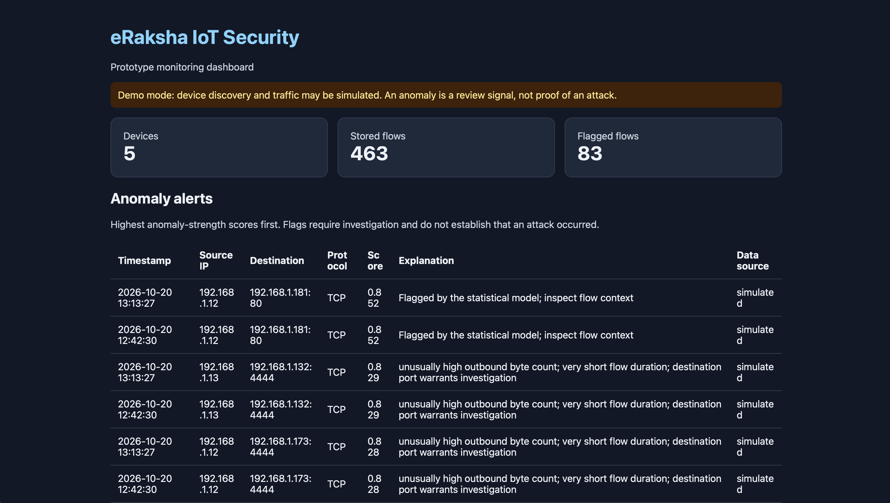
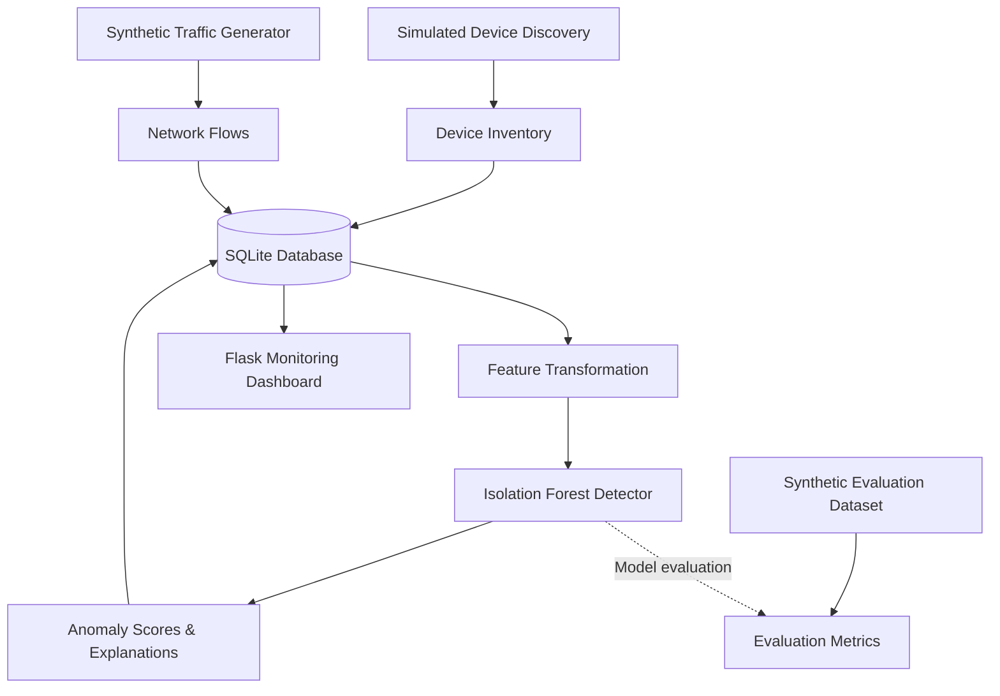

# eRaksha — IoT Security & Network Anomaly Detection

**Team Aegis · Spraha Vats · Indian Institute of Technology Delhi**

[](https://www.python.org/)
[](#testing)
[](#scope-and-limitations)

An extensible IoT security prototype developed from Team Aegis's hackathon concept, combining simulated device discovery, unsupervised network anomaly detection, explainable alerts, SQLite persistence, and a local monitoring dashboard.

## Achievement

**7th place nationwide — e-Raksha National Cybersecurity Hackathon 2026**

Team Aegis placed **7th among approximately 1,500 teams across India** in a 36-hour national cybersecurity hackathon conducted by the CyberPeace Foundation in collaboration with the Ministry of Home Affairs.

The original project concept explored an agentic approach to IoT security, bringing together device discovery, network anomaly detection, video analytics, and deception-based threat intelligence. This repository develops a reproducible software prototype of selected components.

## Dashboard Preview



## Architecture



The current pipeline is designed for reproducible experimentation. Device discovery and traffic generation are simulated by default; the prototype does not claim to monitor a live network.

## Implemented Features

### 1. Simulated Device Inventory
- Generates a reproducible inventory of example IoT devices.
- Tracks device attributes and records whether an entry is simulated or observed.
- Persists device records in SQLite.

### 2. Unsupervised Network Anomaly Detection
- Uses an Isolation Forest model from scikit-learn.
- Learns a reference distribution from normal synthetic traffic.
- Evaluates flow features including outbound bytes, inbound bytes, and duration.
- Produces anomaly scores and threshold-based flags.

### 3. Explainable Alerts
- Adds human-readable heuristic explanations to flagged flows.
- Persists detection results for inspection.
- Treats anomaly scores as indicators of unusual behaviour, **not probabilities of an attack**.

### 4. Persistent Storage
- Uses SQLite to store device inventory, network flows, anomaly scores, flags, and explanations.
- Initializes the database schema and supports a migration for the device-source field.

### 5. Local Monitoring Dashboard
- Displays device inventory and traffic summaries.
- Lists flagged flows with anomaly explanations.
- Exposes a local status endpoint at `/api/status`.
- Binds to `127.0.0.1` for local development.

## Technology Stack

| Technology | Purpose |
|---|---|
| Python | Core implementation |
| NumPy | Numerical operations |
| scikit-learn | Isolation Forest anomaly detection |
| SQLite | Persistent storage |
| Flask | Monitoring dashboard and status API |
| pytest | Automated testing |
| Scapy | Networking-related development dependency |

## Getting Started

### Prerequisites

- Python 3.15.0, as used during development
- Git
- A terminal and web browser

### 1. Clone the repository

```bash
git clone https://github.com/sprahavats/eRaksha-IoT-Security.git
cd eRaksha-IoT-Security
```

### 2. Create and activate a virtual environment

```bash
python3.15 -m venv .venv
source .venv/bin/activate
```

### 3. Install dependencies

```bash
python